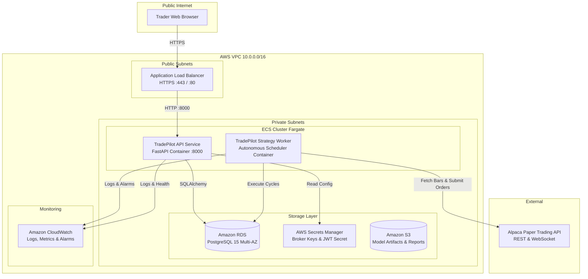

# TradePilot — AWS Production Architecture & Deployment Guide

## 1. Architecture Overview

TradePilot is designed as a modular, containerized application with strict separation between public stateless HTTP endpoints, autonomous background execution, persistent storage, and brokerage adapters.



---

## 2. Component Breakdown

### 2.1 Networking & Security
- **VPC (`10.0.0.0/16`)**: Multi-AZ layout across `us-east-1a` and `us-east-1b`.
- **Public Subnets (`10.0.1.0/24`, `10.0.2.0/24`)**: Host the internet-facing Application Load Balancer with AWS Certificate Manager (ACM) SSL/TLS termination.
- **Private Subnets (`10.0.10.0/24`, `10.0.11.0/24`)**: Host ECS Fargate containers (API and Worker) and Amazon RDS PostgreSQL database without public IP addresses.
- **Security Groups**:
  - `ALB-SG`: Ingress `443` (HTTPS) from `0.0.0.0/0`.
  - `ECS-Tasks-SG`: Ingress `8000` strictly from `ALB-SG`.
  - `RDS-SG`: Ingress `5432` strictly from `ECS-Tasks-SG`.

### 2.2 Container Workloads (Amazon ECS on AWS Fargate)
1. **API Service (`deploy/Dockerfile.api`)**:
   - Stateless FastAPI REST API handling user authentication, order intents, predictions inspection, and health probes (`/health`, `/ready`).
   - Automatically scales horizontally based on CPU/memory utilization.
2. **Strategy Worker (`deploy/Dockerfile.worker`)**:
   - Autonomous background worker process running the strategy scheduling loop.
   - Evaluates universe lookbacks, executes Random Forest inference, passes proposals through Centralized Risk Engine, and reconciles state with Alpaca Paper API.
   - Run as a single coordinated instance to guarantee zero duplicate cycle execution.

### 2.3 Storage Layer
- **Amazon RDS for PostgreSQL 15**:
  - Managed relational database storing users, agent states, cycles, predictions, signals, order intents, broker orders, fills, and audit trails.
  - Multi-AZ deployment with automated daily snapshots and point-in-time recovery.
- **Amazon S3**:
  - Versioned bucket storing trained machine learning models (`best_model.joblib`), metadata, backtest reports, and MLflow artifacts.
- **AWS Secrets Manager**:
  - Centralized storage for Alpaca API key/secret, JWT secret, and database connection strings with least-privilege IAM task execution roles.

---

## 3. Step-by-Step Deployment Procedure

### Step 1: Build & Push Container Images to Amazon ECR
```bash
# 1. Authenticate Docker with Amazon ECR
aws ecr get-login-password --region us-east-1 | docker login --username AWS --password-stdin <AWS_ACCOUNT_ID>.dkr.ecr.us-east-1.amazonaws.com

# 2. Build and push API image
docker build -f deploy/Dockerfile.api -t tradepilot-api:latest .
docker tag tradepilot-api:latest <AWS_ACCOUNT_ID>.dkr.ecr.us-east-1.amazonaws.com/tradepilot-api:latest
docker push <AWS_ACCOUNT_ID>.dkr.ecr.us-east-1.amazonaws.com/tradepilot-api:latest

# 3. Build and push Worker image
docker build -f deploy/Dockerfile.worker -t tradepilot-worker:latest .
docker tag tradepilot-worker:latest <AWS_ACCOUNT_ID>.dkr.ecr.us-east-1.amazonaws.com/tradepilot-worker:latest
docker push <AWS_ACCOUNT_ID>.dkr.ecr.us-east-1.amazonaws.com/tradepilot-worker:latest
```

### Step 2: Provision Infrastructure with Terraform
```bash
cd deploy/terraform
terraform init
terraform plan -out=tfplan
terraform apply tfplan
```

### Step 3: Run Database Migrations on RDS
```bash
# Execute Alembic migration through ECS one-off task or Bastion host
alembic upgrade head
```

---

## 4. Rollback Procedure

If a deployment triggers alarms or regression:
1. **ECS Deployment Rollback**:
   ```bash
   # Revert ECS service to previous task definition revision
   aws ecs update-service --cluster tradepilot-cluster --service tradepilot-api --task-definition tradepilot-api:<PREVIOUS_REVISION>
   aws ecs update-service --cluster tradepilot-cluster --service tradepilot-worker --task-definition tradepilot-worker:<PREVIOUS_REVISION>
   ```
2. **Database Rollback**:
   ```bash
   alembic downgrade -1
   ```

---

## 5. Backup & Recovery Strategy

1. **Automated RDS Snapshots**: Daily backup retention set to 7 days, allowing 5-minute Point-in-Time Recovery (PITR).
2. **Manual Pre-Deployment Snapshot**:
   ```bash
   aws rds create-db-snapshot --db-instance-identifier tradepilot-db --db-snapshot-identifier tradepilot-pre-deploy-$(date +%s)
   ```
3. **Restoring from Snapshot**:
   ```bash
   aws rds restore-db-instance-from-db-snapshot --db-instance-identifier tradepilot-db-restored --db-snapshot-identifier <SNAPSHOT_ID>
   ```

---

## 6. Estimated Monthly Cloud Infrastructure Costs

| Service Component | Configuration Specification | Estimated Monthly Cost (USD) |
|---|---|---|
| **Amazon ECS on Fargate** | 2 Tasks (API + Worker), 0.5 vCPU, 1 GB RAM | ~$30.00 |
| **Amazon RDS PostgreSQL** | `db.t4g.micro` (Single-AZ dev / Multi-AZ prod) | ~$15.00 - $32.00 |
| **Application Load Balancer** | 1 ALB, ~5 GB processed data/month | ~$18.00 |
| **Amazon S3 & ECR** | ~10 GB model & image storage | ~$2.00 |
| **AWS Secrets Manager** | 2 secret items | ~$0.80 |
| **Amazon CloudWatch** | Logs ingestion & basic alarms | ~$3.00 |
| **Total Estimated Cost** | — | **~$68.80 - $85.80 / month** |
